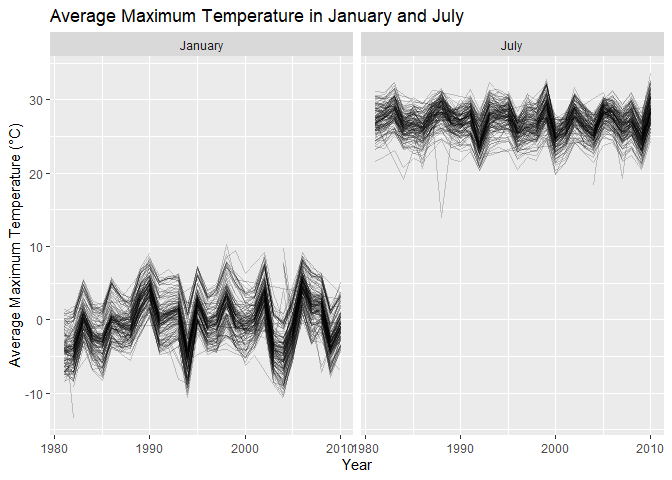
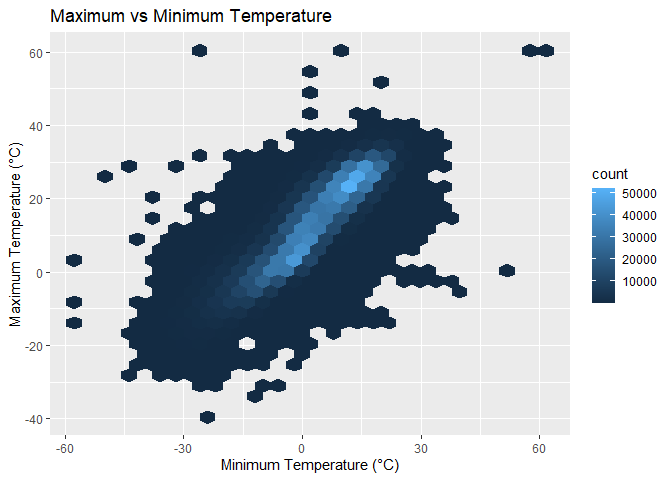
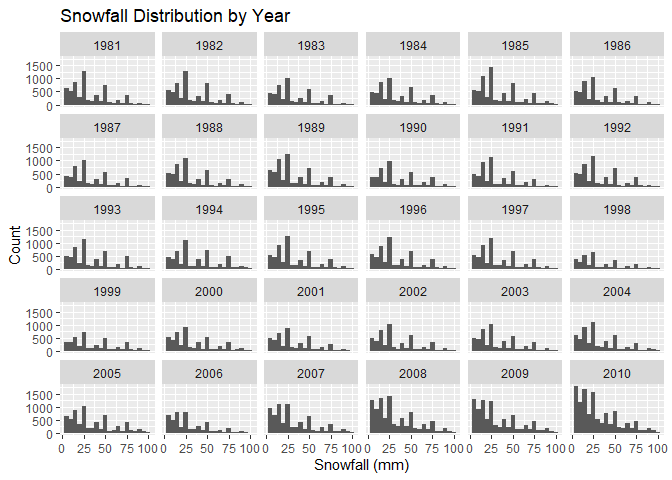
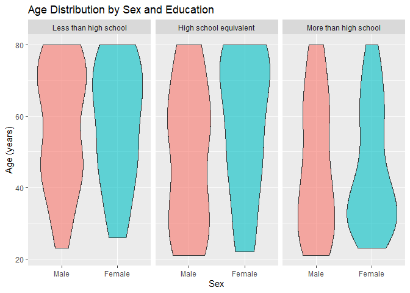
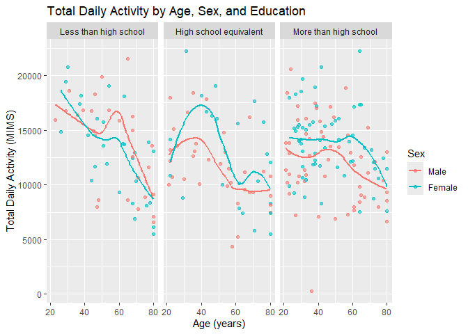
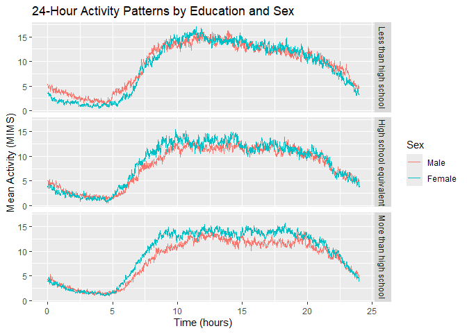
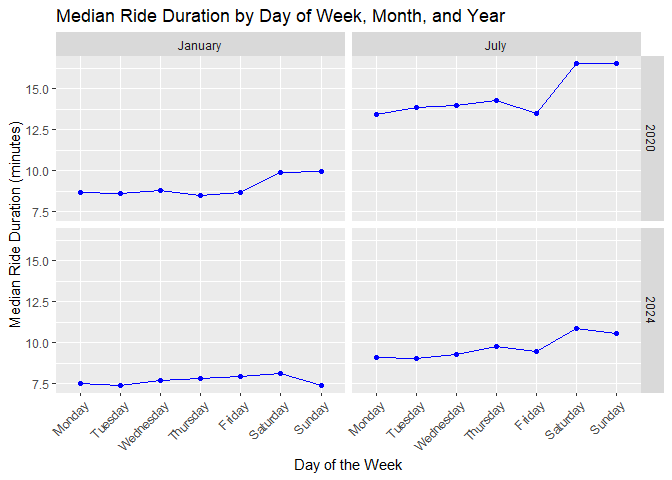
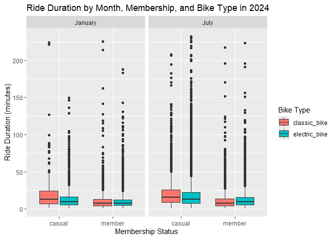

p8105_hw3_yl6371
================
Yutong
2026-10-18

``` r
library(tidyverse)
```

    ## ── Attaching core tidyverse packages ──────────────────────── tidyverse 2.0.0 ──
    ## ✔ dplyr     1.2.1     ✔ readr     2.2.0
    ## ✔ forcats   1.0.1     ✔ stringr   1.6.0
    ## ✔ ggplot2   4.0.3     ✔ tibble    3.3.1
    ## ✔ lubridate 1.9.5     ✔ tidyr     1.3.2
    ## ✔ purrr     1.2.2     
    ## ── Conflicts ────────────────────────────────────────── tidyverse_conflicts() ──
    ## ✖ dplyr::filter() masks stats::filter()
    ## ✖ dplyr::lag()    masks stats::lag()
    ## ℹ Use the conflicted package (<http://conflicted.r-lib.org/>) to force all conflicts to become errors

``` r
library(p8105.datasets)
data("ny_noaa")
```

## Problem 1

``` r
ny_noaa |>
  summarize(across(everything(), ~sum(is.na(.))))
```

    ## # A tibble: 1 × 7
    ##      id  date   prcp   snow   snwd    tmax    tmin
    ##   <int> <int>  <int>  <int>  <int>   <int>   <int>
    ## 1     0     0 145838 381221 591786 1134358 1134420

The dataset contains 2595176 observations and 7 variables. The key
variables include weather station ID, observation date, precipitation,
snowfall, snow depth, maximum temperature, and minimum temperature.

The id and date variables have no missing values.

The tmax and tmin have approximately 44% missing values.

``` r
ny_noaa_clean = 
  ny_noaa |> 
  mutate(
  year = lubridate::year(date),
  month = lubridate::month(date),
  day = lubridate::day(date),
  tmax = as.numeric(tmax) / 10,
  tmin = as.numeric(tmin) / 10,
  prcp = prcp / 10
)
```

``` r
ny_noaa_clean |> 
  count(snow, sort = TRUE)
```

    ## # A tibble: 282 × 2
    ##     snow       n
    ##    <int>   <int>
    ##  1     0 2008508
    ##  2    NA  381221
    ##  3    25   31022
    ##  4    13   23095
    ##  5    51   18274
    ##  6    76   10173
    ##  7     8    9962
    ##  8     5    9748
    ##  9    38    9197
    ## 10     3    8790
    ## # ℹ 272 more rows

The most commonly observed snowfall value is 0 mm. It has 2008508
observations. Because most days there is no snowfall in New York.

``` r
jan_jul_tmax =
  ny_noaa_clean |> 
  filter(month %in% c(1,7)) |> 
  group_by(id, year, month) |> 
  summarize(
    mean_tmax = mean(tmax, na.rm = TRUE),
    .groups = "drop"
  ) |> 
  filter(!is.na(mean_tmax))
```

``` r
jan_jul_tmax |>
  ggplot(aes(x = year, y = mean_tmax, group = id)) +
  geom_line(alpha = 0.2) +
  facet_grid(. ~ month, labeller = as_labeller(c("1" = "January", "7" = "July"))) +
  labs(
    title = "Average Maximum Temperature in January and July",
    x = "Year",
    y = "Average Maximum Temperature (°C)"
  )
```

<!-- -->

The plot shows a seasonal difference in average maximum temperatures.
January temperatures are much lower than July temperatures. Each
temperature pattern is relatively consistent and has regular
fluctuations.

There are some outliers. There are some low average tmax in July which
are unusual.

``` r
ny_noaa_clean |>
  ggplot(aes(x = tmin, y = tmax)) +
  geom_hex() +
  labs(
    title = "Maximum vs Minimum Temperature",
    x = "Minimum Temperature (°C)",
    y = "Maximum Temperature (°C)"
  )
```

    ## Warning: Removed 1136276 rows containing non-finite outside the scale range
    ## (`stat_binhex()`).

<!-- -->

``` r
ny_noaa_clean |>
  filter(snow > 0, snow < 100) |>
  ggplot(aes(x = snow)) +
  geom_histogram(binwidth = 5) +
  facet_wrap(~ year) +
  labs(
    title = "Snowfall Distribution by Year",
    x = "Snowfall (mm)",
    y = "Count"
  )
```

<!-- -->

## Problem 2

``` r
nhanes_accel =
  read_csv("data/nhanes_accel.csv")
```

    ## Rows: 250 Columns: 1441
    ## ── Column specification ────────────────────────────────────────────────────────
    ## Delimiter: ","
    ## dbl (1441): SEQN, min1, min2, min3, min4, min5, min6, min7, min8, min9, min1...
    ## 
    ## ℹ Use `spec()` to retrieve the full column specification for this data.
    ## ℹ Specify the column types or set `show_col_types = FALSE` to quiet this message.

``` r
nhanes_covar =
  read_csv(
    "data/nhanes_covar.csv",
    skip = 5,
    col_names = c("SEQN", "sex", "age", "BMI", "education")
  )
```

    ## Rows: 250 Columns: 5
    ## ── Column specification ────────────────────────────────────────────────────────
    ## Delimiter: ","
    ## dbl (5): SEQN, sex, age, BMI, education
    ## 
    ## ℹ Use `spec()` to retrieve the full column specification for this data.
    ## ℹ Specify the column types or set `show_col_types = FALSE` to quiet this message.

``` r
nhanes_covar_clean =
  nhanes_covar |>
  filter(age >= 21) |>
  drop_na()
```

``` r
nhanes_covar_clean =
  nhanes_covar_clean |>
  mutate(
    sex = factor(
      sex,
      levels = c(1, 2),
      labels = c("Male", "Female")
    ),
    education = factor(
      education,
      levels = c(1, 2, 3),
      labels = c(
        "Less than high school",
        "High school equivalent",
        "More than high school"
      )
    )
  )
```

``` r
nhanes_df =
  left_join(
    nhanes_covar_clean,
    nhanes_accel,
    by = "SEQN"
  )
```

``` r
nhanes_df |>
  count(education, sex) |>
  pivot_wider(
    names_from = sex,
    values_from = n
  ) |>
  knitr::kable()
```

| education              | Male | Female |
|:-----------------------|-----:|-------:|
| Less than high school  |   27 |     28 |
| High school equivalent |   35 |     23 |
| More than high school  |   56 |     59 |

``` r
nhanes_df |>
  ggplot(aes(x = sex, y = age, fill = sex)) +
  geom_violin(alpha = 0.6) +
  facet_grid(. ~ education) +
  labs(
    title = "Age Distribution by Sex and Education",
    x = "Sex",
    y = "Age (years)"
  ) +
  theme(legend.position = "none")
```

<!-- -->

The dataset includes 228 participants, 118 men and 110 women. The
largest education group is “More than high school”, with 115
participants. The number of men is over the number of women in the “High
school equivalent” group, while the numbers of men and women are
relatively similar in the other two groups.

The age distributions vary across education categories and between men
and women. Participants with less than a high school education tend to
be concentrated in older age groups. In the high school equivalent
group, women show a relatively high concentration at older ages. Among
participants with more than a high school education, women are more
concentrated in younger ages.

``` r
nhanes_df =
  nhanes_df |>
  mutate(
    total_activity = rowSums(
      pick(starts_with("min")),
      na.rm = TRUE
    )
  )

nhanes_df |>
  select(SEQN, sex, age, education, total_activity) |>
  head()
```

    ## # A tibble: 6 × 5
    ##    SEQN sex      age education              total_activity
    ##   <dbl> <fct>  <dbl> <fct>                           <dbl>
    ## 1 62161 Male      22 High school equivalent         13194.
    ## 2 62164 Female    44 More than high school          13411.
    ## 3 62169 Male      21 High school equivalent          9991.
    ## 4 62174 Male      80 More than high school           8579.
    ## 5 62177 Male      51 High school equivalent         11918.
    ## 6 62178 Male      80 High school equivalent          7489.

``` r
nhanes_df |>
  ggplot(aes(x = age, y = total_activity, color = sex)) +
  geom_point(alpha = 0.6) +
  geom_smooth(se = FALSE) +
  facet_grid(. ~ education) +
  labs(
    title = "Total Daily Activity by Age, Sex, and Education",
    x = "Age (years)",
    y = "Total Daily Activity (MIMS)",
    color = "Sex"
  )
```

    ## `geom_smooth()` using method = 'loess' and formula = 'y ~ x'

<!-- -->

Total daily activity generally decreases with age, particularly among
older participants.

In the high school equivalent group, women tend to have higher activity
levels than men during middle adulthood.

``` r
nhanes_long =
  nhanes_df |>
  pivot_longer(
    cols = starts_with("min"),
    names_to = "minute",
    values_to = "activity"
  ) |>
  mutate(
    minute = as.numeric(stringr::str_remove(minute, "min"))
  )
```

``` r
nhanes_activity_summary =
  nhanes_long |>
  group_by(education, sex, minute) |>
  summarize(
    mean_activity = mean(activity, na.rm = TRUE),
    .groups = "drop"
  )
```

``` r
nhanes_activity_summary |>
  ggplot(aes(x = minute / 60, y = mean_activity, color = sex)) +
  geom_line() +
  facet_grid(education ~ .) +
  labs(
    title = "24-Hour Activity Patterns by Education and Sex",
    x = "Time (hours)",
    y = "Mean Activity (MIMS)",
    color = "Sex"
  )
```

<!-- -->

The activity patterns across the three educational levels were generally
similar, but differed in curve height and gender differences.

## Problem 3

``` r
jan_2020 =
  read_csv("data/citibike/Jan 2020 Citi.csv.zip")
```

    ## Rows: 12420 Columns: 7
    ## ── Column specification ────────────────────────────────────────────────────────
    ## Delimiter: ","
    ## chr (6): ride_id, rideable_type, weekdays, start_station_name, end_station_n...
    ## dbl (1): duration
    ## 
    ## ℹ Use `spec()` to retrieve the full column specification for this data.
    ## ℹ Specify the column types or set `show_col_types = FALSE` to quiet this message.

``` r
jan_2024 =
  read_csv("data/citibike/Jan 2024 Citi.csv.zip")
```

    ## Rows: 18861 Columns: 7
    ## ── Column specification ────────────────────────────────────────────────────────
    ## Delimiter: ","
    ## chr (6): ride_id, rideable_type, weekdays, start_station_name, end_station_n...
    ## dbl (1): duration
    ## 
    ## ℹ Use `spec()` to retrieve the full column specification for this data.
    ## ℹ Specify the column types or set `show_col_types = FALSE` to quiet this message.

``` r
july_2020 =
  read_csv("data/citibike/July 2020 Citi.csv.zip")
```

    ## Rows: 21048 Columns: 7
    ## ── Column specification ────────────────────────────────────────────────────────
    ## Delimiter: ","
    ## chr (6): ride_id, rideable_type, weekdays, start_station_name, end_station_n...
    ## dbl (1): duration
    ## 
    ## ℹ Use `spec()` to retrieve the full column specification for this data.
    ## ℹ Specify the column types or set `show_col_types = FALSE` to quiet this message.

``` r
july_2024 =
  read_csv("data/citibike/July 2024 Citi.csv.zip")
```

    ## Rows: 47156 Columns: 7
    ## ── Column specification ────────────────────────────────────────────────────────
    ## Delimiter: ","
    ## chr (6): ride_id, rideable_type, weekdays, start_station_name, end_station_n...
    ## dbl (1): duration
    ## 
    ## ℹ Use `spec()` to retrieve the full column specification for this data.
    ## ℹ Specify the column types or set `show_col_types = FALSE` to quiet this message.

``` r
citibike_df =
  bind_rows(
    jan_2020 |> mutate(year = 2020, month = "January"),
    july_2020 |> mutate(year = 2020, month = "July"),
    jan_2024 |> mutate(year = 2024, month = "January"),
    july_2024 |> mutate(year = 2024, month = "July")
  )
```

``` r
citibike_df |>
  group_by(year, month, member_casual) |>
  summarize(
    n_rides = n(),
    .groups = "drop"
  ) |>
  pivot_wider(
    names_from = member_casual,
    values_from = n_rides
  ) |>
  knitr::kable()
```

| year | month   | casual | member |
|-----:|:--------|-------:|-------:|
| 2020 | January |    984 |  11436 |
| 2020 | July    |   5637 |  15411 |
| 2024 | January |   2108 |  16753 |
| 2024 | July    |  10894 |  36262 |

The bike usage has seasonal differences.The number of rides was higher
in July than in January for both 2020 and 2024.

``` r
summary(citibike_df$duration)
```

    ##    Min. 1st Qu.  Median    Mean 3rd Qu.    Max. 
    ##   1.002   5.595   9.839  13.930  17.560 238.780

``` r
citibike_df |>
  group_by(year, month, rideable_type) |>
  summarize(
    mean_duration = mean(duration, na.rm = TRUE),
    .groups = "drop"
  ) |>
  knitr::kable(digits = 2)
```

| year | month   | rideable_type | mean_duration |
|-----:|:--------|:--------------|--------------:|
| 2020 | January | classic_bike  |         11.94 |
| 2020 | January | electric_bike |         17.31 |
| 2020 | July    | classic_bike  |         18.73 |
| 2020 | July    | electric_bike |         24.66 |
| 2024 | January | classic_bike  |         10.82 |
| 2024 | January | electric_bike |         10.64 |
| 2024 | July    | classic_bike  |         12.72 |
| 2024 | July    | electric_bike |         13.89 |

In both 2020 and 2024, average ride durations were longer in July than
in January for both classic and electric bikes.Average ride durations
were lower in 2024 than in 2020 across both months and bike types.

``` r
citibike_df |>
  filter(year == 2024, month == "July") |>
  count(start_station_name, sort = TRUE) |>
  slice_head(n = 5) |>
  knitr::kable()
```

| start_station_name       |   n |
|:-------------------------|----:|
| Pier 61 at Chelsea Piers | 163 |
| University Pl & E 14 St  | 155 |
| W 21 St & 6 Ave          | 152 |
| West St & Chambers St    | 150 |
| W 31 St & 7 Ave          | 146 |

``` r
citibike_median =
  citibike_df |>
  group_by(year, month, weekdays) |>
  summarize(
    median_duration = median(duration, na.rm = TRUE),
    .groups = "drop"
  )
```

``` r
citibike_median |>
  mutate(
    weekdays = factor(
      weekdays,
      levels = c(
        "Monday", "Tuesday", "Wednesday",
        "Thursday", "Friday", "Saturday", "Sunday"
      )
    )
  ) |>
  ggplot(aes(x = weekdays, y = median_duration, group = 1)) +
  geom_line(color = "blue") +
  geom_point(color = "blue") +
  facet_grid(year ~ month) +
  labs(
    title = "Median Ride Duration by Day of Week, Month, and Year",
    x = "Day of the Week",
    y = "Median Ride Duration (minutes)"
  ) +
  theme(
    axis.text.x = element_text(angle = 45, hjust = 1)
  )
```

<!-- -->

Median ride durations were consistently longer in July than in January
in both 2020 and 2024.

Weekend rides generally had longer median durations than weekday rides.

``` r
citibike_df |>
  filter(year == 2024) |>
  ggplot(
    aes(
      x = member_casual,
      y = duration,
      fill = rideable_type
    )
  ) +
  geom_boxplot() +
  facet_grid(. ~ month) +
  labs(
    title = "Ride Duration by Month, Membership, and Bike Type in 2024",
    x = "Membership Status",
    y = "Ride Duration (minutes)",
    fill = "Bike Type"
  )
```

<!-- -->

Casual riders generally had longer median ride durations and greater
variability than Citi Bike members.

The differences between classic and electric bikes depended on
membership status.

All groups showed right-skewed distributions with many high-duration
outliers.
